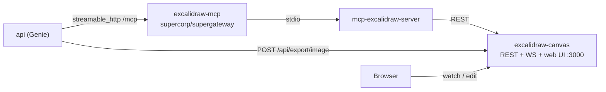

# Connect Excalidraw MCP to Genie

## Why a separate node, not just extra tools

Genie binds tools only inside the researcher node, with a hard ceiling of three calls:

```82:91:app/agents/genie_graph.py
    mcp_client = MultiServerMCPClient(
        {
            "deep_search": {
                "transport": "streamable_http",
                "url": settings.mcp_server_url,
            },
        }
    )
    mcp_tools = await mcp_client.get_tools()
    tools = [web_search, *mcp_tools]
```

Dropping Excalidraw's 26 tools into that list would bloat the researcher prompt and have drawing compete with research for the same three-call budget. Instead the Excalidraw tools get their own node with its own budget, and `get_tools(server_name=...)` keeps the two tool sets separate.

## Server choice and transport

Use [yctimlin/mcp_excalidraw](https://github.com/yctimlin/mcp_excalidraw) — it is the only option with headless PNG rendering (v2.1+, no browser tab, works in Docker), which is what makes inline images possible. Its MCP server is stdio-only ("This project does not expose MCP at `/mcp` or `/sse`"), so a `supergateway` container bridges stdio to streamable HTTP, which is the transport Genie already speaks. No new Dockerfile and no changes to the GHCR build matrix.



## 1. Compose services

In [docker-compose.yml](docker-compose.yml), alongside the existing `mcp` service:

```yaml
  excalidraw-canvas:
    image: ghcr.io/yctimlin/mcp_excalidraw-canvas:latest
    container_name: excalidraw_canvas
    environment:
      HOST: 0.0.0.0
      PORT: "3000"
      EXCALIDRAW_DATA_DIR: /data
    ports:
      - "3000:3000"
    volumes:
      - excalidraw-data:/data

  excalidraw-mcp:
    image: supercorp/supergateway:latest
    container_name: excalidraw_mcp
    depends_on:
      - excalidraw-canvas
    environment:
      EXPRESS_SERVER_URL: http://excalidraw-canvas:3000
      EXCALIDRAW_NO_AUTOSTART: "1"
      ENABLE_CANVAS_SYNC: "true"
    command:
      - --stdio
      - npx -y mcp-excalidraw-server@2
      - --outputTransport
      - streamableHttp
      - --streamableHttpPath
      - /mcp
      - --port
      - "3001"
```

`api` gains a `diagrams:/data/diagrams` volume for the rendered PNGs.

Verify first (one `curl` each): that the canvas container answers `GET /health`, and that `POST /api/export/image {"format":"png","scale":2}` renders headlessly with no browser tab open. The pre-2.1 code path returned `503 No frontend client connected`; if the pinned version still does, fall back to the `export_to_image` MCP tool writing into a volume shared with `api`.

## 2. Settings and static serving

[app/core/config.py](app/core/config.py) gains, all optional so the feature is off by default:

- `excalidraw_mcp_url: str = ""` — `http://excalidraw-mcp:3001/mcp`
- `excalidraw_canvas_url: str = ""` — `http://excalidraw-canvas:3000`
- `diagram_dir: str = "/data/diagrams"`
- `public_base_url: str = "http://localhost:8000"`
- `diagram_retention_days: int = 7`

[app/main.py](app/main.py) creates `diagram_dir` at startup, prunes files older than the retention window, and mounts `StaticFiles(directory=settings.diagram_dir)` at `/static/diagrams`. Filenames are UUIDs; note in the README that this path is unauthenticated, which is why the names are unguessable.

## 3. Graph changes

[app/agents/genie_graph.py](app/agents/genie_graph.py):

- Register `"excalidraw"` as a second entry on `MultiServerMCPClient` (only when `excalidraw_mcp_url` is set), then split the tool sets: `research_tools = [web_search, *await mcp_client.get_tools(server_name="deep_search")]` and `draw_tools = await mcp_client.get_tools(server_name="excalidraw")`.
- Filter `draw_tools` to a whitelist so the drawing prompt stays small: `read_diagram_guide`, `clear_canvas`, `batch_create_elements`, `update_element`, `delete_element`, `describe_scene`, `align_elements`, `distribute_elements`. Skip `create_from_mermaid` and `set_viewport` — both still need a browser tab.
- New `visualizer` node placed before `writer`, so the writer's streamed answer is never blocked on drawing. It runs its own bounded loop (`MAX_DIAGRAM_TOOL_CALLS = 6`) over `draw_tools`, seeded from a new `visualizer-prompt`, then renders the canvas to PNG in Python (not via the LLM): `POST {canvas}/api/export/image` with `{"format": "png", "scale": 2}`, base64-decode, write `{diagram_dir}/{uuid4}.png`, and return `diagram_url = f"{public_base_url}/static/diagrams/{id}.png"`.
- Wrap the whole node in a module-level `asyncio.Lock` and start with `clear_canvas`: there is one shared canvas, so concurrent conversations must not interleave.
- Emit `🎨 Sketching a diagram...` through `emit_status` like the other nodes. Messages from this node stream under `langgraph_node == "visualizer"`, which `completions.py` already ignores since it filters on `writer`.
- Routing: `route_after_plan` returns `researcher` / `visualizer` / `writer`; `route_after_research` returns `tools` / `visualizer` / `writer`; `visualizer` always edges to `writer`. Any failure in the node logs and returns an empty `diagram_url` rather than failing the request.

[app/schemas/agent.py](app/schemas/agent.py): `Plan` gains `needs_diagram: bool` and `diagram_brief: str` so the planner decides when a visual actually helps; `AgentState` gains `needs_diagram`, `diagram_brief`, `diagram_messages`, and `diagram_url`.

## 4. Delivering the image to LibreChat

The URL is appended in code, never retyped by the model. In [app/api/routes/completions.py](app/api/routes/completions.py) the streaming path adds `"updates"` to `stream_mode`, captures `diagram_url` from the `visualizer` update, and emits one final content chunk `\n\n` after the writer's last token. The non-streaming path appends the same markdown to `result["answer"]`. No change to the `writer-synth-prompt` is needed.

## 5. Langfuse

One new **chat** prompt, `visualizer-prompt`, labeled `production`, with variables `question`, `notes`, `diagram_brief`, and `MAX_DRAW_CALLS`. It should instruct the model to call `read_diagram_guide` once, then lay the diagram out in a single `batch_create_elements` call with explicit coordinates and arrow `startElementId`/`endElementId` bindings.

Because [app/core/langfuse_client.py](app/core/langfuse_client.py) fails startup on any missing prompt, add `visualizer` to `PromptBundle` as `ChatPromptTemplate | None` and only load it when `excalidraw_mcp_url` is set, so deployments without the canvas keep booting.

## 6. Tests and docs

- `tests/test_visualizer.py`: the canvas render helper against a mocked `POST /api/export/image` (success, 503, malformed base64), and an assertion that the researcher's tool list contains no Excalidraw tools.
- Per the repo's documentation rules: update [README.md](README.md) (architecture, stack table, project structure, prerequisites, Langfuse prompt list, env var table, frontend features, deployment notes on the two new services and the unauthenticated static path), append a `FEATURE` entry to [DEVELOPMENT.md](DEVELOPMENT.md), and create `.env.example` — the README references it but the file does not exist in the repo.
- Production is deployed by ArgoCD from `Vedasur/apps-k3s-config`; both new services use public images, so no change to [.github/workflows/build-and-push.yml](.github/workflows/build-and-push.yml), but the gitops repo needs the two deployments added (and the canvas needs a persistent volume if you want diagrams to survive restarts).